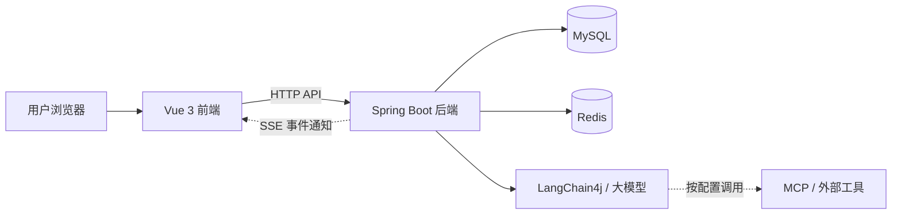

# ✈️ TripMate

```{=html}
<p align="center">
```
`<strong>`{=html}AI 驱动的多人协作旅行规划平台`</strong>`{=html}
`<br />`{=html} 让每位旅行成员都能参与规划，让行程制定更轻松。

```{=html}
</p>
```
```{=html}
<p align="center">
```
``{=html}
```{=html}
</p>
```
## 📖 项目简介

TripMate 是一个基于 **Vue 3、Java、Spring Boot 和 LangChain4j** 构建的
AI 多人协作旅行规划网站。

和朋友一起旅行时，每个人的预算、兴趣和旅行节奏可能都不一样。传统方式通常需要一个人收集需求、整理攻略，再反复协调和修改行程。

TripMate
希望把这些步骤整合到同一个旅行空间中：成员可以共同参与旅行规划，系统根据旅行信息和成员偏好生成行程，并支持在讨论中通过
`@AI` 提出修改需求。

## 🖼️ 页面预览

------------------------------------------------------------------------------
  首页                                创建旅行
----------------------------------- ------------------------------------------


------------------------------------------------------------------------------

--------------------------------------------------------------------------------------------------
  旅行房间                                     成员偏好
-------------------------------------------- -----------------------------------------------------


--------------------------------------------------------------------------------------------------

---------------------------------------------------------------------------
  AI 生成的行程                          讨论与 @AI 调整
-------------------------------------- ------------------------------------
 

---------------------------------------------------------------------------

## ✨ 核心功能

### 🧳 旅行创建与成员邀请

-   创建旅行，设置目的地、旅行天数和预算等基本信息。
-   通过邀请链接或邀请码邀请其他成员加入。
-   在同一个旅行空间中集中管理旅行信息。

### 👥 多人偏好收集

-   收集成员的个人预算、旅行节奏和活动偏好。
-   记录本次旅行的成员偏好，作为行程规划的参考。
-   尽量兼顾不同成员的需求，减少反复沟通成本。

### 🤖 AI 行程生成

-   根据目的地、旅行时间、预算和成员偏好生成多日行程。
-   将行程组织为按天排列的活动安排，包含时间、地点、活动说明等信息。
-   为活动提供预算估算，帮助用户提前了解行程开销。

### 💬 旅行讨论与 `@AI` 调整

-   成员可以围绕同一份旅行计划进行讨论。
-   支持在讨论中向 AI 描述修改需求。
-   AI可以根据用户提出的需求生成行程调整建议，帮助成员迭代完善旅行计划。

### 🔄 协作状态同步

-   使用服务端事件推送（SSE）通知客户端旅行数据发生变化。
-   客户端收到通知后，可重新读取对应业务数据，保持页面状态同步。
-   对旅行消息进行分页查询，避免一次性加载过多历史记录。

## 🧰 技术栈

  模块               技术
------------------ ----------------------------------
  前端               Vue 3
  后端               Java 21、Spring Boot 3
  AI 应用            LangChain4j、OpenAI 兼容模型接口
  数据访问           MyBatis-Flex
  关系型数据库       MySQL 8
  缓存与分布式能力   Redis、Redi sson
  实时通知           Server-Sent Events（SSE）
  API 文档           Springdoc OpenAPI、Knife4j
  部署与运行         Linux、Docker Compose、Nginx

> AI 模型、地图及交通等外部工具的可用性取决于实际配置的服务与 API Key。

## 🏗️ 系统结构



## 🧩 项目结构

``` text
tripmate/
├── frontend/             # Vue 3 前端
├── tripmate/             # Spring Boot 后端
├── sql/                  # 数据库相关 SQL 脚本
├── tripmate-demo/        # 演示相关文件
├── 后端接口文档.md        # 后端接口文档
└── 前端生成提示词.md      # 前端开发相关提示词
```

## 🚀 本地运行

### 环境要求

-   Java 21
-   Maven
-   Node.js 22（建议使用与项目配置匹配的版本）
-   MySQL 8
-   Redis 7

### 运行前准备

1.  克隆项目：

    ``` bash
    git clone https://github.com/xiolangovo77/tripmate.git
    cd tripmate
    ```

2.  根据 `sql/` 目录中的 SQL 脚本创建数据库并初始化表结构。

3.  配置后端的数据库、Redis 和 AI 模型等连接信息。请将 API
    Key、数据库密码等敏感信息放在本地配置或环境变量中，不要提交到公开仓库。

4.  按实际项目配置分别启动后端和前端。

### 启动后端

``` bash
cd tripmate
mvn spring-boot:run
```

### 启动前端

``` bash
cd frontend
npm install
npm run dev
```

> 如果本地目录、启动脚本或配置项与上述示例不同，请以仓库中的实际文件和项目配置为准。

## 🔍 项目实践与技术亮点

-   **AI 应用集成：** 使用 LangChain4j
    将大模型能力融入旅行规划与对话流程。
-   **结构化行程管理：**
    将旅行、成员、行程及行程明细等业务数据进行拆分管理。
-   **缓存与并发控制：** 使用 Redis / Redisson
    支持缓存、分布式锁等场景。
-   **实时协作通知：** 通过 SSE 推送旅行数据变更通知。
-   **接口与权限设计：** 围绕旅行成员关系和操作权限组织业务接口。
-   **完整项目交付：** 覆盖前后端开发、数据库设计、AI 接入和 Linux
    环境部署等环节。

## 🗺️ 后续计划

-   持续优化 AI 行程生成的响应速度和内容质量。
-   完善行程调整建议的确认与应用流程。
-   增加自动化测试、异常场景处理和部署说明。
-   根据实际使用反馈迭代交互体验。

## 📄 文档

-   [后端接口文档](后端接口文档.md)
-   [前端生成提示词](前端生成提示词.md)

## 🙌 反馈与交流

欢迎体验和提出建议。如果你发现问题或有功能想法，可以通过 GitHub Issues
反馈。

------------------------------------------------------------------------

```{=html}
<p align="center">
```
Made with ❤️ for better group trips.
```{=html}
</p>
```
